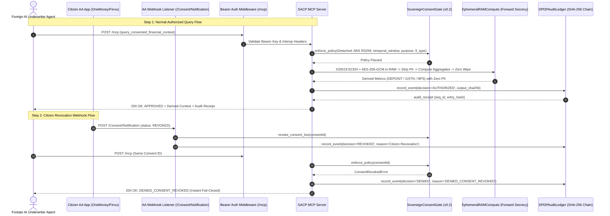

# Sovereign Agentic Context Protocol (SACP) v0.2

[](https://www.python.org/)
[](LICENSE)
[](https://modelcontextprotocol.io/)
[](https://api.rebit.org.in/)
[](https://www.meity.gov.in/)

The **Sovereign Agentic Context Protocol (SACP)** is a zero-retention, cryptographically verifiable financial context gateway for autonomous AI agents, anchored in the **Reserve Bank of India (RBI) / ReBIT Account Aggregator (AA)** technical standards v2.0+ and compliant with India's **Digital Personal Data Protection (DPDP) Act, 2023**.

---

## Architecture & Data Flow (v0.2)



---

## Key Guarantees & Features (v0.2)

1. **ReBIT Detached JWS (`x-jws-signature`)**: Supports ReBIT v2.0+ standard detached signatures (`header..signature` RS256 over raw payload bytes) alongside legacy embedded tokens.
2. **Forward-Secrecy Ephemeral Decryption**: Uses Curve25519 (`X25519`) ECDH key agreement with HKDF-SHA256 and authenticated `AES-256-GCM` decryption directly into RAM.
3. **Multi-FI Type Support**:
   * **`DEPOSIT`**: Inflow, outflow, and net surplus calculation; strips name, PAN, account numbers, and contact details.
   * **`GSTN`**: Turnover, taxable values, and invoice counts; strips GSTIN, legal name, trade name, and PAN.
   * **`NPS`**: Tier 1 and Tier 2 retirement pension contributions; strips PRAN and subscriber identities.
4. **Guaranteed Buffer Zero-Wiping**: In-RAM mutable buffers (`bytearray`) are overwritten with `0x00` in a guaranteed `finally:` block.
5. **Live Citizen Revocation Webhook**: FastAPI/Starlette webhook handler (`POST /Consent/Notification`) enables citizen revocation on mobile AA apps (OneMoney, Finvu, Setu, Anumati) to halt AI agents in real time.
6. **Tamper-Evident SHA-256 Audit Trail**: Every authorization and denial is chained sequentially (`prev_hash` $\rightarrow$ `entry_hash`), creating an immutable cryptographic record verifiable via the `verify_sovereign_audit_trail` tool.

---

## Quickstart & Verification

### Prerequisites
* Python 3.12+
* Virtual environment (`.venv`)

### Installation & Test Execution

```bash
# Clone and enter directory
cd /home/lakshya/.gemini/antigravity/scratch/sacp-mvp

# Run comprehensive test suite (16 tests across cryptographic & gate modules)
.venv/bin/pytest -v tests/
```

### Live Foreign AI Agent Simulation

To run the end-to-end live client demonstration simulating a foreign underwriting agent executing calls against the SACP MCP Server:

```bash
.venv/bin/python scripts/simulate_foreign_agent.py
```

This demo script will:
* Programmatically launch the SACP MCP server over Streamable HTTP on `0.0.0.0:8000/mcp`.
* **Call 1**: Submit a valid RS256 JWS consent artefact + encrypted Indian bank payload with PII $\rightarrow$ Returns `APPROVED` cashflow metrics with a cryptographic `audit_receipt` and confirms 0 PII leaked.
* **Call 2**: Simulate citizen exercising their legal right to revoke consent (`is_revoked_live=True`) $\rightarrow$ Immediately returns `DENIED_CONSENT_REVOKED`.
* **Call 3**: Query `verify_sovereign_audit_trail` $\rightarrow$ Confirms complete SHA-256 hash-chain integrity.
* Cleanly terminate the background server subprocess on completion.

---

## Production Deployment with Docker

### 1. Configure Environment

Copy `.env.example` to `.env` and configure your credentials:

```bash
cp .env.example .env
```

Key environment variables:
* `AA_PUBLIC_KEY_PEM`: Public RSA-2048 key of the Account Aggregator.
* `FI_DECRYPTION_KEY`: Ephemeral Fernet key for legacy mock decryption.
* `FIU_X25519_PRIVATE_KEY`: Private X25519 key (PEM) for forward-secrecy ECDH decryption.
* `SACP_CLIENT_API_KEY`: Bearer token secret required for `/mcp` endpoints.
* `DATABASE_URL`: PostgreSQL connection string (e.g. Supabase Mumbai `ap-south-1`).

### 2. Build & Run Container

```bash
# Build multi-stage non-root container
docker build -t sacp-mcp:latest .

# Run container exposing port 8000
docker run -d \
  --name sacp-mcp-server \
  -p 8000:8000 \
  --env-file .env \
  sacp-mcp:latest
```

---

## Model Context Protocol (MCP) Tools

| Tool Name | Type | Description |
| :--- | :--- | :--- |
| `query_consented_financial_context` | Action | Cryptographically validates consent (Detached JWS / Embedded JWS), enforces policy gates, ephemerally computes zero-PII aggregates (DEPOSIT, GSTN, NPS) via X25519 forward secrecy, and returns a signed audit receipt. |
| `verify_sovereign_audit_trail` | Inspection | Traverses the append-only SHA-256 audit ledger from genesis to head, verifying chain health and DPDP Act compliance. |

---

## License & Specifications

* **Detailed Protocol Specification:** [`SPEC.md`](file:///home/lakshya/.gemini/antigravity/scratch/sacp-mvp/SPEC.md)
* **License:** [Apache-2.0](LICENSE)
